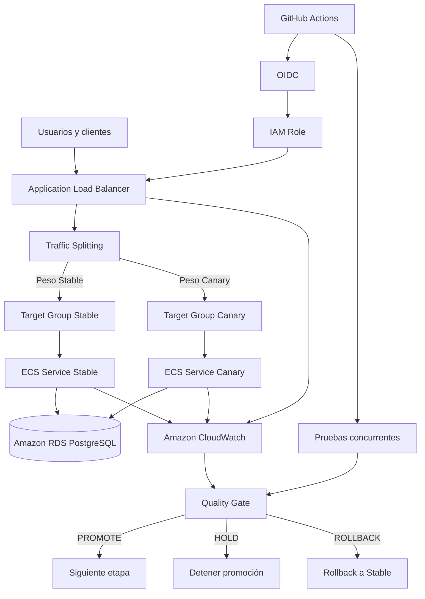
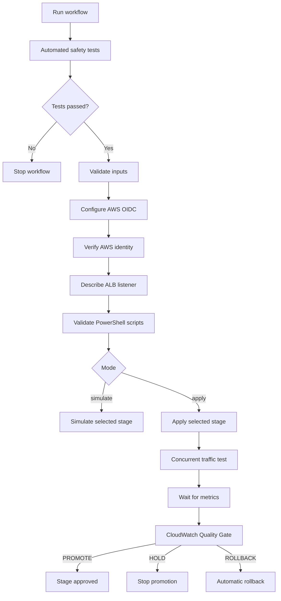

# 🐾 Pet Adoption API – Canary Deployment en AWS

API REST para la gestión de animales, adoptantes y adopciones, con una estrategia de despliegue progresivo **Canary Deployment** sobre Amazon Web Services (AWS).

El proyecto permite mantener dos versiones de la API ejecutándose simultáneamente, distribuir el tráfico entre ellas mediante porcentajes configurables y evaluar el comportamiento de la nueva versión antes de promoverla completamente a producción.

La solución incorpora automatización CI/CD, monitoreo con Amazon CloudWatch, pruebas de carga concurrente, un Quality Gate y un mecanismo de recuperación mediante rollback.

## 📖 Descripción del proyecto

Pet Adoption API es un servicio backend desarrollado con Node.js y Express que administra la información relacionada con el proceso de adopción de mascotas.

Sus principales entidades son:

- **Animal:** información de los animales disponibles para adopción.
- **Adoptante:** información de las personas interesadas en adoptar.
- **Adopción:** registro y administración de los procesos de adopción.

La persistencia de datos se realiza mediante PostgreSQL y Prisma ORM.

Como parte de la evolución del proyecto, se implementó una estrategia de despliegue Canary en AWS. Esta estrategia permite introducir una nueva versión del API sin retirar inmediatamente la versión estable.

La nueva versión recibe inicialmente una proporción controlada del tráfico. Durante cada etapa se evalúan las métricas de rendimiento, errores y consumo de recursos. Dependiendo de los resultados, el proceso puede continuar, detenerse o ejecutar una reversión.

### Objetivos

- Mantener disponibles simultáneamente las versiones Stable y Canary.
- Controlar la distribución del tráfico mediante porcentajes.
- Identificar qué versión y track atienden cada solicitud.
- Evaluar el rendimiento mediante pruebas concurrentes.
- Monitorear las señales doradas de observabilidad.
- Automatizar las decisiones de promoción mediante un Quality Gate.
- Recuperar el tráfico hacia Stable cuando se detecte una regresión.
- Reducir el riesgo asociado a los despliegues de nuevas versiones.

---

## 🛠️ Tecnologías utilizadas

| Tecnología | Función |
|---|---|
| Node.js | Entorno de ejecución |
| Express | Framework backend |
| Prisma ORM | Acceso y administración de datos |
| PostgreSQL | Base de datos relacional |
| Amazon ECS | Ejecución de contenedores |
| Amazon ECR | Almacenamiento de imágenes |
| Application Load Balancer | Distribución de tráfico |
| Amazon RDS | Base de datos administrada |
| Amazon CloudWatch | Métricas, alarmas y monitoreo |
| AWS IAM | Control de acceso |
| GitHub Actions | Automatización CI/CD |
| GitHub Actions OIDC | Autenticación temporal con AWS |
| PowerShell | Automatización de despliegues y pruebas |
| Bash | Ejecución de pruebas automatizadas |
| Terraform | Infraestructura como código |
| Docker | Construcción y empaquetado de la API |

---

## 🏗️ Arquitectura general

La infraestructura utiliza Amazon ECS para ejecutar las dos versiones del API y un Application Load Balancer para distribuir las solicitudes entre ellas.

El balanceador cuenta con dos Target Groups:

- Target Group Stable.
- Target Group Canary.

Cada Target Group se encuentra asociado a su respectivo servicio ECS.

Amazon CloudWatch recopila métricas de los servicios y del balanceador. Estas métricas son utilizadas por el Quality Gate para evaluar si la nueva versión cumple los criterios de promoción.

GitHub Actions coordina el proceso de despliegue y se autentica en AWS mediante OIDC.

### Diagrama de arquitectura



### Flujo general

1. El usuario realiza una solicitud al API.
2. El Application Load Balancer recibe la solicitud.
3. El listener determina el Target Group según los pesos configurados.
4. El servicio ECS correspondiente procesa la solicitud.
5. La aplicación consulta PostgreSQL cuando necesita acceder a los datos.
6. Las métricas de ejecución se recopilan en CloudWatch.
7. El Quality Gate evalúa los resultados.
8. La automatización decide si continúa la promoción o ejecuta rollback.

---

## ☁️ Infraestructura AWS

La solución se encuentra desplegada en AWS, en la región `us-east-1`.

### Recursos principales

| Recurso | Identificador |
|---|---|
| Región | `us-east-1` |
| Cluster ECS | `pet-adoption-demo-cluster` |
| Servicio Stable | `pet-adoption-demo-api` |
| Servicio Canary | `pet-adoption-demo-api-canary` |
| Application Load Balancer | `pet-adoption-demo-alb` |
| Target Group Stable | `pet-adoption-demo-tg` |
| Target Group Canary | `pet-adoption-demo-canary-tg` |
| Repositorio ECR | `pet-adoption-api` |

### Servicios ECS

| Característica | Stable | Canary |
|---|---|---|
| Servicio | `pet-adoption-demo-api` | `pet-adoption-demo-api-canary` |
| Versión | 3.0.2 | 4.0.4 |
| Task Definition | Revisión 7 | Revisión 5 |
| Réplicas deseadas | 1 | 1 |
| Réplicas ejecutándose | 1 | 1 |

Los servicios se mantienen activos simultáneamente para permitir una recuperación rápida en caso de que la versión Canary presente problemas.

### Base de datos

La aplicación utiliza PostgreSQL mediante Amazon RDS.

Prisma ORM administra el acceso a los datos y las migraciones del esquema.

Las credenciales y la cadena de conexión se gestionan mediante variables de entorno y recursos de AWS, evitando almacenar información sensible directamente en el código.

---

## 🔀 Versiones Stable y Canary

La implementación mantiene dos versiones del API:

**Stable**

- Versión desplegada: `3.0.2`.
- Servicio: `pet-adoption-demo-api`.
- Representa la versión estable disponible como alternativa de recuperación.

**Canary**

- Versión desplegada: `4.0.4`.
- Servicio: `pet-adoption-demo-api-canary`.
- Contiene la versión más reciente que se evalúa durante la estrategia de promoción.

La aplicación contiene rutas versionadas para las diferentes versiones del API.

Entre las rutas implementadas se encuentra:

```http
/api/v3
/api/v4
```

El endpoint utilizado para las pruebas de recomendaciones es:

```http
GET /api/v4/animals/recommendations
```

**Nota sobre el versionado:** el despliegue actualmente registrado utiliza Stable 3.0.2 y Canary 4.0.4. Esto debe distinguirse de la nomenclatura v2/v3 mencionada como ejemplo en el enunciado académico.

---

## 🚦 Estrategia Canary Deployment

Canary Deployment permite liberar una nueva versión gradualmente, exponiéndola inicialmente a un porcentaje pequeño de usuarios.

En lugar de reemplazar completamente la versión anterior, ambas permanecen disponibles mientras se evalúa la nueva implementación.

### Plan de promoción

| Etapa | Stable | Canary | Objetivo |
|---|---:|---:|---|
| Etapa 0 | 100 % público | 0 % público | Pruebas internas y de humo |
| Etapa 1 | 95 % | 5 % | Exposición inicial |
| Etapa 2 | 75 % | 25 % | Evaluación intermedia |
| Etapa 3 | 50 % | 50 % | Incremento de exposición |
| Etapa 4 | 0 % | 100 % | Promoción completa |

La etapa 0 permite probar Canary mediante una regla interna sin asignarle tráfico público.

### Tiempo de observación

La configuración actual de promoción utiliza:

| Parámetro | Valor |
|---|---:|
| Tiempo de observación (Bake Time) | 2 minutos |
| Espera adicional de CloudWatch | 120 segundos |
| Solicitudes de prueba concurrente | 1.000 |
| Trabajadores concurrentes | 20 |
| Ventana de evaluación de métricas | 5 minutos |
| Mínimo de solicitudes para Quality Gate | 20 |

El tiempo de observación se configura en:

`scripts/canary-promote.ps1`

Parámetros principales:

```powershell
[int]$BakeMinutes = 2,
[int]$CloudWatchDelaySeconds = 120,
[int]$ConcurrentRequests = 1000,
[int]$ConcurrentWorkers = 20,
[int]$WindowMinutes = 5,
[int]$MinRequests = 20
```

Cada etapa se ejecuta individualmente mediante GitHub Actions.

El tiempo de observación y la ventana de evaluación de CloudWatch son parámetros distintos: reducir el Bake Time no implica reducir automáticamente la ventana de métricas.

### Mecanismo de distribución

El Application Load Balancer utiliza pesos en sus Target Groups para controlar el porcentaje de solicitudes que recibe cada versión.

Ejemplo de configuración para una etapa del 25 %:

```text
Stable: 75 %
Canary: 25 %
```

La modificación se realiza sobre la acción predeterminada del listener.

---

## 🏷️ Identificación de versión y track

Para identificar qué versión atendió una solicitud, la aplicación incorpora middleware de versionado.

Las respuestas deben permitir identificar:

- La versión del API.
- El track que atendió la solicitud: `stable` o `canary`.

Los encabezados utilizados son:

```http
X-App-Version
X-App-Track
```

Ejemplo conceptual:

```http
HTTP/1.1 200 OK
X-App-Version: 4.0.4
X-App-Track: canary
Content-Type: application/json
```

La identificación permite:

- Diferenciar las respuestas de Stable y Canary.
- Analizar el tráfico por versión.
- Verificar la distribución realizada por el balanceador.
- Asociar métricas y errores con una versión específica.

---

## 🔐 Acceso interno a Canary

Además del tráfico público, se configuró una regla independiente en el listener para permitir pruebas internas de la versión Canary.

La regla utiliza:

```http
X-Canary: true
```

También requiere una dirección IP de origen autorizada.

Esto permite ejecutar pruebas directamente sobre Canary sin modificar el porcentaje de tráfico público.

La regla interna se mantiene separada de la acción predeterminada del listener, por lo que las modificaciones de los porcentajes públicos no deben eliminarla.

La dirección IP autorizada debe administrarse como configuración de infraestructura y no exponerse innecesariamente en documentación pública.

---

## 📊 Observabilidad y monitoreo

La infraestructura utiliza Amazon CloudWatch para monitorear el comportamiento de los servicios Stable y Canary.

Se implementó un dashboard de CloudWatch mediante Terraform.

Archivo:

`terraform/dashboard.tf`

Nombre del dashboard:

`pet-adoption-demo-canary-dashboard`

### Métricas monitoreadas

**Tráfico**

- Número de solicitudes recibidas por Stable.
- Número de solicitudes recibidas por Canary.

**Errores HTTP**

- Errores HTTP 4xx.
- Errores HTTP 5xx.

**Latencia**

- Percentil 50 (p50).
- Percentil 95 (p95).
- Percentil 99 (p99).

**Saturación**

- Utilización de CPU.
- Utilización de memoria.

El dashboard contiene comparaciones lado a lado entre Stable y Canary para facilitar el análisis del comportamiento de ambas versiones.

### Métricas de negocio

La aplicación utiliza la métrica personalizada:

```text
AnimalRecommendationRequests
```

Esta métrica permite contabilizar solicitudes relacionadas con las recomendaciones de animales.

Se identifica mediante las dimensiones:

```text
AppVersion=v4
AppTrack=canary
```

Esto permite diferenciar las solicitudes procesadas por la nueva versión.

---

## 🎯 SLI, SLO y Quality Gate

El Quality Gate es el mecanismo encargado de evaluar si la versión Canary cumple los criterios mínimos de calidad.

Su implementación se encuentra en:

`scripts/canary-quality-gate.ps1`

### Umbrales configurados

| Indicador | Umbral |
|---|---:|
| Mínimo de solicitudes | 20 |
| Tasa máxima de errores 5xx | 1 % |
| Latencia máxima p95 | 1 segundo |
| CPU | Alarma de CloudWatch |
| Memoria | Alarma de CloudWatch |

### Decisiones

El Quality Gate tiene tres posibles resultados:

| Decisión | Código de salida | Significado |
|---|---:|---|
| PROMOTE | 0 | Canary cumple los criterios |
| HOLD | 1 | Evidencia insuficiente o métricas no concluyentes |
| ROLLBACK | 2 | Se incumple un umbral crítico |

### PROMOTE

Se produce cuando:

- Existe una muestra suficiente de solicitudes.
- La tasa de errores 5xx está dentro del límite.
- La latencia p95 cumple el umbral.
- Las alarmas de recursos no indican una condición crítica.

La etapa puede considerarse aprobada.

### HOLD

Se produce cuando:

- La cantidad de solicitudes es insuficiente.
- Las métricas no están disponibles.
- No existe evidencia concluyente para tomar una decisión.

En este escenario no se debe promover la nueva versión.

### ROLLBACK

Se produce cuando se detecta una violación crítica de los criterios establecidos.

El proceso de promoción debe detenerse y se debe recuperar el tráfico hacia Stable.

---

## 🧪 Pruebas de carga concurrente

Para evaluar el comportamiento de Canary se implementó un script de pruebas concurrentes:

`scripts/canary-concurrent-test.ps1`

El script genera solicitudes hacia el endpoint de recomendaciones y registra información sobre:

- Código HTTP.
- Versión que respondió.
- Track que respondió.
- Tiempo de respuesta.
- Cantidad de solicitudes por versión.
- Errores registrados.

La configuración utilizada para las pruebas fue:

| Parámetro | Valor |
|---|---:|
| Solicitudes por ejecución | 1.000 |
| Trabajadores concurrentes | 20 |
| Endpoint | `/api/v4/animals/recommendations` |
| Modo | Público |
| Resultado | Archivo CSV |

Los resultados se exportan en archivos con el formato:

```text
scripts/canary-concurrent-<timestamp>.csv
```

Estos archivos permiten conservar evidencia de las pruebas y analizar posteriormente la distribución real del tráfico.

---

## ⚠️ Inyección de fallos

La estrategia contempla la posibilidad de provocar una regresión controlada en Canary para comprobar la capacidad de detección del Quality Gate.

La inyección de fallos debe afectar exclusivamente a la versión Canary.

El objetivo es simular escenarios como:

- Incremento de errores HTTP 500.
- Aumento de latencia.
- Degradación del comportamiento del endpoint.

La simulación puede utilizar parámetros o variables de entorno habilitados exclusivamente para pruebas controladas.

La versión Stable debe permanecer sin alteraciones.

**Importante:** la validación de la lógica ROLLBACK mediante métricas simuladas no equivale a demostrar una inyección de fallos real sobre AWS. La evidencia de un evento real debe documentarse por separado.

---

## 🔄 Rollback y recuperación

El mecanismo de rollback permite restablecer el tráfico público hacia la versión Stable cuando Canary presenta una regresión.

Script:

`scripts/canary-rollback.ps1`

### Distribución después del rollback

```text
Stable: 100 %
Canary: 0 %
```

El proceso realiza las siguientes acciones:

1. Consulta la configuración actual del listener.
2. Verifica los Target Groups configurados.
3. Construye la nueva acción predeterminada.
4. Establece Stable con peso 100.
5. Establece Canary con peso 0.
6. Modifica el listener cuando se ejecuta en modo real.

El script incluye un modo de simulación:

```powershell
.\scripts\canary-rollback.ps1 -DryRun
```

Este modo muestra la configuración que se aplicaría, sin modificar AWS.

Para ejecutar el rollback sin confirmación interactiva:

```powershell
.\scripts\canary-rollback.ps1 -Force
```

El mecanismo de rollback modifica la acción predeterminada del listener y conserva la regla interna de acceso Canary.

---

## ⚙️ Automatización con GitHub Actions

La estrategia Canary se automatiza mediante:

`.github/workflows/canary-deploy.yml`

Nombre del workflow:

`Canary - Controlled Promotion`

El workflow se ejecuta manualmente desde la pestaña Actions del repositorio.

### Parámetros de ejecución

| Parámetro | Opciones |
|---|---|
| Branch | `feature/canary-deployment-v4` |
| Stage | 5, 25, 50, 100 |
| Mode | simulate, apply |
| Confirmation | PROMOVER para apply |

### Flujo del pipeline



### Trabajos del workflow

**1. Canary automated safety tests**

Ejecuta pruebas aisladas para validar:

- PROMOTE.
- HOLD.
- ROLLBACK.
- Rollback DryRun.

El trabajo de promoción depende de que estas pruebas terminen correctamente.

**2. Canary stage**

Ejecuta la etapa seleccionada:

- Valida la configuración.
- Se autentica en AWS.
- Consulta el listener.
- Ejecuta el script de promoción.
- Evalúa métricas.
- Aprueba o revierte la etapa.

### Modos de ejecución

**simulate**

Permite validar el flujo de ejecución sin modificar los pesos reales del listener.

**apply**

Ejecuta la modificación real de la distribución de tráfico y realiza las validaciones posteriores.

Para autorizarlo se requiere escribir exactamente:

```text
PROMOVER
```

Los artefactos CSV generados por las pruebas pueden almacenarse como artefactos de GitHub Actions.

---

## 🔑 Autenticación AWS mediante OIDC

GitHub Actions utiliza OpenID Connect (OIDC) para autenticarse en AWS.

Este mecanismo permite obtener credenciales temporales sin almacenar claves de acceso permanentes en GitHub Secrets.

### Rol IAM

```text
github-actions-pet-adoption-canary
```

### Permisos principales

| Permiso | Función |
|---|---|
| `elasticloadbalancing:DescribeListeners` | Consultar el listener |
| `elasticloadbalancing:ModifyListener` | Modificar la distribución de tráfico |
| `cloudwatch:GetMetricStatistics` | Consultar métricas |
| `cloudwatch:DescribeAlarms` | Consultar alarmas |

El permiso de modificación se restringe al listener del despliegue.

La confianza OIDC se limita al repositorio y a la rama autorizada.

---

## 🗄️ Compatibilidad de datos: Expand/Contract

La estrategia Expand/Contract permite evolucionar el esquema de la base de datos sin impedir que la versión anterior continúe funcionando.

El objetivo es evitar migraciones destructivas durante el periodo en el que Stable y Canary conviven.

### Fase 1: Expand

Se realizan cambios compatibles con la versión anterior.

Ejemplos:

- Agregar columnas opcionales.
- Crear nuevas tablas.
- Agregar índices.
- Mantener los campos utilizados por Stable.
- Evitar eliminar o renombrar columnas existentes.

### Fase 2: Migrate and Deploy

Se despliega la nueva versión utilizando el esquema ampliado.

Durante esta etapa:

- Stable continúa funcionando.
- Canary utiliza las nuevas funcionalidades.
- Ambas versiones mantienen compatibilidad con la base de datos.

### Fase 3: Contract

Una vez que la nueva versión ha sido promovida y se ha confirmado que la versión anterior ya no necesita utilizar el esquema antiguo, se pueden retirar los elementos obsoletos.

Esta etapa debe realizarse de manera independiente y controlada.

### Consideraciones

- No realizar migraciones destructivas durante la promoción Canary.
- Mantener compatibilidad con la versión Stable.
- No eliminar columnas que todavía utiliza la versión anterior.
- Conservar la posibilidad de rollback.
- Verificar la compatibilidad de los datos antes de retirar elementos antiguos.

**Estado de evidencia:** la estrategia de compatibilidad se documenta como diseño de la solución. Para afirmar que Expand/Contract fue comprobado, se deben adjuntar las migraciones y las pruebas que demuestren la compatibilidad simultánea de ambas versiones.

---

## 📁 Estructura del repositorio

La estructura principal del proyecto está organizada de la siguiente manera:

```text
Api_Pet_Adoption/
│
├── .github/
│   └── workflows/
│       └── canary-deploy.yml
│
├── prisma/
│   ├── migrations/
│   ├── schema.prisma
│   └── seed.js
│
├── scripts/
│   ├── canary-promote.ps1
│   ├── canary-quality-gate.ps1
│   ├── canary-rollback.ps1
│   ├── canary-load-test.ps1
│   ├── canary-concurrent-test.ps1
│   └── destroy-infra.ps1
│
├── tests/
│   └── canary/
│       ├── mock-bin/
│       │   └── aws
│       └── run-canary-tests.sh
│
├── src/
│   ├── app.js
│   ├── server.js
│   ├── instrumentation.js
│   ├── controllers/
│   ├── middlewares/
│   ├── repositories/
│   ├── routes/
│   ├── services/
│   ├── v3/
│   └── v4/
│
├── terraform/
│   ├── alb.tf
│   ├── cloudwatch.tf
│   ├── dashboard.tf
│   ├── ecr.tf
│   ├── ecs.tf
│   ├── network.tf
│   ├── outputs.tf
│   ├── providers.tf
│   ├── rds.tf
│   ├── secrets.tf
│   ├── security_groups.tf
│   ├── variables.tf
│   └── versions.tf
│
├── monitoring/
│
├── Dockerfile
├── docker-compose.yml
├── package.json
├── package-lock.json
├── .env.example
└── README.md
```

Los archivos de infraestructura, scripts y pruebas se mantienen versionados para facilitar la reproducción del despliegue y la auditoría de los cambios.

---

## 🔧 Configuración del entorno

### Requisitos

- Node.js.
- npm.
- Git.
- Docker y Docker Compose para la ejecución local.
- PowerShell para los scripts de automatización.
- AWS CLI para consultar y administrar recursos.
- Terraform para gestionar infraestructura.
- Cuenta AWS con permisos adecuados.
- Acceso al repositorio de GitHub.

### Variables de entorno

Crear un archivo `.env` a partir de `.env.example`.

Variables principales:

```env
PORT=3000
NODE_ENV=development
DATABASE_URL=
```

La cadena de conexión debe apuntar a la base de datos correspondiente al entorno.

No subir el archivo `.env` ni credenciales reales al repositorio.

---

## 💻 Ejecución local

### 1. Clonar el repositorio

```bash
git clone https://github.com/AngelAvirama/Api_Pet_Adoption.git
cd Api_Pet_Adoption
```

### 2. Instalar dependencias

```bash
npm install
```

### 3. Configurar variables de entorno

```bash
cp .env.example .env
```

En Windows PowerShell:

```powershell
Copy-Item .env.example .env
```

Completar `DATABASE_URL` con los datos de la base de datos local.

### 4. Generar Prisma Client

```bash
npx prisma generate
```

### 5. Aplicar migraciones

```bash
npx prisma migrate deploy
```

### 6. Ejecutar el proyecto

```bash
npm run dev
```

La API utiliza el puerto configurado en `PORT`, con 3000 como puerto habitual de desarrollo.

### 7. Verificar disponibilidad

```http
GET /api/health
```

Respuesta esperada:

```json
{
  "status": "ok"
}
```

---

## 🧪 Ejecución de pruebas automatizadas

### Pruebas del Quality Gate

En Linux o GitHub Actions:

```bash
bash tests/canary/run-canary-tests.sh
```

Este comando ejecuta cuatro escenarios:

| Prueba | Resultado esperado |
|---|---|
| PROMOTE | Código 0 |
| HOLD | Código 1 |
| ROLLBACK | Código 2 |
| Rollback DryRun | Código 0 |

El ejecutable simulado de AWS evita realizar modificaciones reales durante estas pruebas.

### Pruebas de carga concurrente

El script correspondiente es:

```text
scripts/canary-concurrent-test.ps1
```

Ejemplo:

```powershell
.\scripts\canary-concurrent-test.ps1 `
  -Requests 1000 `
  -Workers 20 `
  -Mode Public
```

Los parámetros pueden variar según la configuración del script y el entorno de ejecución.

### Validación de sintaxis

Los scripts PowerShell pueden validarse desde PowerShell 7:

```powershell
$files = @(
    "scripts/canary-promote.ps1",
    "scripts/canary-quality-gate.ps1",
    "scripts/canary-rollback.ps1",
    "scripts/canary-concurrent-test.ps1"
)

foreach ($file in $files) {
    $tokens = $null
    $errors = $null

    [System.Management.Automation.Language.Parser]::ParseFile(
        (Resolve-Path $file),
        [ref]$tokens,
        [ref]$errors
    ) | Out-Null

    if ($errors.Count -gt 0) {
        Write-Host "ERROR: $file"
        $errors | ForEach-Object { Write-Host $_ }
        exit 1
    }

    Write-Host "OK: $file"
}
```

---

## 🚀 Procedimiento de despliegue

El proceso se realiza desde GitHub Actions.

### 1. Abrir el workflow

Ingresar al repositorio:

```text
GitHub → Actions → Canary - Controlled Promotion
```

### 2. Seleccionar la rama

```text
feature/canary-deployment-v4
```

### 3. Seleccionar la etapa

Las etapas disponibles son:

```text
5
25
50
100
```

Cada ejecución procesa una sola etapa.

### 4. Seleccionar el modo

**simulate**

Ejecuta una simulación sin modificar los pesos reales del listener.

**apply**

Realiza la modificación real del listener y ejecuta las pruebas y validaciones.

Para `apply`, introducir:

```text
PROMOVER
```

### 5. Revisar resultados

Verificar:

- Pruebas automatizadas aprobadas.
- Autenticación AWS correcta.
- Listener consultado correctamente.
- Distribución de tráfico aplicada.
- Prueba concurrente ejecutada.
- Métricas de CloudWatch consultadas.
- Quality Gate aprobado.
- Artefactos CSV generados.

### 6. Verificar el tráfico real

Para consultar la distribución del listener:

```powershell
aws elbv2 describe-listeners `
  --listener-arns "<LISTENER_ARN>" `
  --region us-east-1 `
  --query "Listeners[0].DefaultActions"
```

Para consultar los servicios ECS:

```powershell
aws ecs describe-services `
  --cluster pet-adoption-demo-cluster `
  --services pet-adoption-demo-api pet-adoption-demo-api-canary `
  --region us-east-1 `
  --query "services[*].[serviceName,desiredCount,runningCount,status]"
```

Estos comandos permiten comprobar que la distribución del tráfico y el estado de los servicios coinciden con la etapa ejecutada.

---

## 📈 Resultados obtenidos

### 1. Pruebas concurrentes de tráfico público

Se realizaron pruebas de 1.000 solicitudes por etapa.

| Etapa | Stable | Canary | Solicitudes Stable | Solicitudes Canary | Errores |
|---|---:|---:|---:|---:|---:|
| 5 % | 95 % | 5 % | 944 | 56 | 0 |
| 25 % | 75 % | 25 % | 755 | 245 | 0 |
| 50 % | 50 % | 50 % | 525 | 475 | 0 |
| 100 % | 0 % | 100 % | 0 | 1.000 | 0 |

**Resumen:**

- Solicitudes totales: 4.000.
- Solicitudes con errores registrados: 0.
- Etapas evaluadas: 4.
- Distribución observada: coherente con los pesos configurados.

### 2. Resultados de latencia

Los resultados de las pruebas concurrentes registraron:

| Etapa | Canary promedio | Canary p95 | Canary p99 |
|---|---:|---:|---:|
| 5 % | 255,54 ms | 346,09 ms | 393,18 ms |
| 25 % | 284,98 ms | 409,66 ms | 526,64 ms |
| 50 % | 310,82 ms | 290,06 ms | 482,32 ms |
| 100 % | 250,58 ms | 276,60 ms | 303,59 ms |

Los valores corresponden a los registros de las pruebas concurrentes y deben interpretarse como mediciones de cada ejecución, no como una serie de latencias acumuladas.

### 3. Resultados de CloudWatch

Durante las validaciones registradas se observaron:

- Cero errores 4xx contabilizados en las ventanas reportadas.
- Cero errores 5xx contabilizados en las ventanas reportadas.
- Tasa de errores 5xx del 0 %.
- Alarmas de CPU y memoria Canary en estado OK.
- Latencias p95 reportadas inferiores a un segundo en las ventanas consultadas.

Las métricas del balanceador y las mediciones del script concurrente corresponden a fuentes y ventanas de observación diferentes.

### 4. Pruebas automatizadas del Quality Gate

Se ejecutaron los cuatro escenarios aislados:

| Escenario | Solicitudes | Errores 5xx | Tasa 5xx | Latencia p95 | Resultado |
|---|---:|---:|---:|---:|---|
| PROMOTE | 100 | 0 | 0 % | 0,200 s | Aprobado |
| HOLD | 2 | 0 | 0 % | 0,200 s | Aprobado |
| ROLLBACK | 105 | 5 | 4,76 % | 0,200 s | Aprobado |

Resultados:

```text
Aprobadas: 4
Fallidas: 0
```

La prueba ROLLBACK demuestra que una tasa de errores superior al 1 % genera la decisión de reversión.

La prueba HOLD demuestra que una muestra inferior a 20 solicitudes no permite aprobar la promoción.

La prueba Rollback DryRun comprobó que el script construye la configuración Stable 100 % / Canary 0 % sin ejecutar una modificación real de AWS.

### 5. Validación de infraestructura

Durante la verificación del 6 de noviembre de 2026 se obtuvo:

| Servicio ECS | Deseadas | Ejecutándose | Estado |
|---|---:|---:|---|
| Stable | 1 | 1 | ACTIVE |
| Canary | 1 | 1 | ACTIVE |

La distribución pública verificada en esa revisión fue:

```text
Stable: 0 %
Canary: 100 %
```

Ambos servicios permanecían activos.

### 6. Ejecución real de GitHub Actions

Se verificó una ejecución satisfactoria del workflow `Canary - Controlled Promotion`, incluyendo:

- Job de pruebas automatizadas aprobado.
- Job de etapa Canary aprobado.
- Ejecución en modo `apply` reportada como funcional.

La ejecución debe conservarse como evidencia mediante su enlace, sus logs y el artefacto CSV generado.

**Importante:** el resultado de las pruebas aisladas no debe confundirse con una prueba real de rollback provocada por inyección de fallos. Esa evidencia debe registrarse de manera independiente.

---

## 🔒 Seguridad y buenas prácticas

La implementación considera las siguientes prácticas:

- Uso de OIDC para autenticación entre GitHub Actions y AWS.
- Credenciales temporales en lugar de claves permanentes.
- Permisos IAM limitados a las operaciones requeridas.
- Separación de servicios Stable y Canary.
- Protección de variables de entorno sensibles.
- No almacenar archivos `.env` con credenciales reales en GitHub.
- Mantener Stable activo durante el proceso de promoción.
- Validar los cambios del listener antes de ejecutar una promoción real.
- Conservar logs y artefactos de las pruebas.
- Mantener la regla de acceso interno Canary independiente de la distribución pública.

---

## 📝 Conclusiones

La implementación de Canary Deployment en Pet Adoption API permite introducir nuevas versiones de manera progresiva y controlada sobre AWS.

La infraestructura mantiene dos servicios ECS activos simultáneamente y utiliza Application Load Balancer para distribuir el tráfico según los porcentajes definidos.

GitHub Actions automatiza el proceso de promoción y utiliza OIDC para autenticarse de manera segura en AWS.

Amazon CloudWatch proporciona las métricas de monitoreo utilizadas por el Quality Gate para evaluar errores, latencia y saturación de recursos.

Las pruebas concurrentes realizadas en las etapas 5 %, 25 %, 50 % y 100 % procesaron un total de 4.000 solicitudes sin errores registrados.

Las pruebas automatizadas validaron correctamente los escenarios PROMOTE, HOLD y ROLLBACK, además de la configuración de recuperación mediante DryRun.

La solución proporciona una base para realizar despliegues progresivos, reducir el riesgo de introducir regresiones y mantener una alternativa de recuperación mediante la versión Stable.

---

## 📚 Evidencias para la entrega

Para complementar este README, se recomienda conservar en el repositorio o en la documentación de entrega:

1. Diagrama de arquitectura AWS.
2. Captura del listener mostrando la distribución Stable/Canary.
3. Captura de los dos servicios ECS en estado activo.
4. Dashboard CloudWatch con comparación de métricas.
5. Logs de las pruebas concurrentes.
6. Resultados de las cuatro pruebas automatizadas.
7. Ejecución satisfactoria de GitHub Actions en modo `apply`.
8. CSV de la prueba de carga.
9. Evidencia de inyección de fallos y rollback real.
10. Evidencia de compatibilidad de datos Expand/Contract.
11. Identificación de versiones y digest de las imágenes desplegadas.

---

## 👨‍💻 Autoría

**Proyecto:** Pet Adoption API  
**Repositorio:** [AngelAvirama/Api_Pet_Adoption](https://github.com/AngelAvirama/Api_Pet_Adoption)  
**Cloud Provider:** Amazon Web Services  
**Región:** us-east-1  
**Estrategia:** Canary Deployment  
**Automatización:** GitHub Actions + AWS OIDC  
**Infraestructura como código:** Terraform

