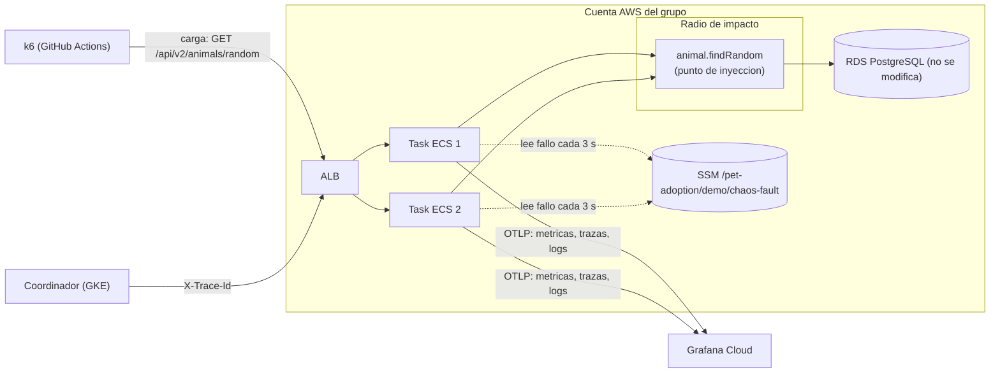
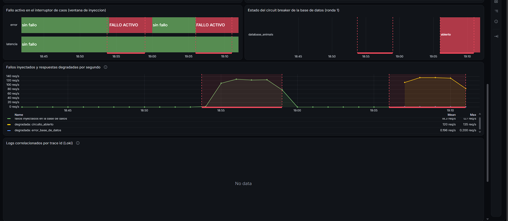
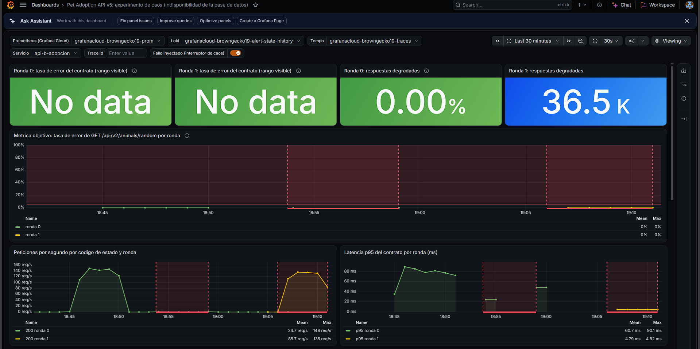

# Informe de experimento: indisponibilidad de la base de datos de la API de adopcion

Entrega final de Ingenieria del Caos, enfasis DevOps (release `v5.0.0`). Integrante: Angel Avirama.
Fallo asignado: **(b) indisponibilidad de una dependencia**. Ejecutado el 2026-11-16 (hora de Colombia,
UTC-5) sobre la cuenta AWS del grupo, con datos sinteticos (seed de Prisma) y en una ventana acordada con
el grupo.

## 1. Contexto y radio de impacto

La API de adopcion (AWS: ALB + ECS Fargate con 2 tasks + RDS PostgreSQL) es la **primera dependencia** del
flujo sincrono del grupo: el coordinador de Leonardo (GKE) llama a `GET /api/v2/animals/random` y luego a la
API de vuelos de Juan (OCI), propagando `X-Trace-Id` y `traceparent`.

- **Punto de inyeccion:** solo la consulta `animal.findRandom`, en los dos tasks del servicio ECS
  `pet-adoption-demo-api`. RDS, el ALB, `/api/health`, el resto de rutas y las APIs de GCP y OCI no se tocan.
- **Donde se mide:** la metrica objetivo la mide k6 en el cliente; Grafana Cloud mide lo mismo desde dentro
  (contador `http_server_requests_total` por ruta, codigo y ronda).

## 2. Estado estable medido

Medido con `chaos-gate.yml` en modo `estado-estable` (mismo perfil, sin fallo), 18:44:55 a 18:49:55:

| Medida | Valor |
|---|---|
| Peticiones al contrato | 39 801 |
| Tasa de error | 0,0025 % (1 peticion) |
| Throughput | 133,7 peticiones/s |
| Latencia p95 / p99 | 169 ms / 406 ms |

Con ese valor se confirma el umbral declarado en `chaos/slo.json` (5 %).

## 3. Hipotesis, metrica y metodo

**Hipotesis falsable.** Dado el perfil de carga P (10 VU en bucle cerrado: 30 s de subida, 4 min sostenidos y
30 s de bajada), cuando la base de datos de la API de adopcion falle de forma sostenida (100 % de las consultas
del animal aleatorio) durante los 5 minutos de la carga, la API mantendra la tasa de error de
`GET /api/v2/animals/random` por debajo del 5 %.

**Metrica objetivo unica:** tasa de error del contrato (`http_req_failed` del escenario `carga` de k6).
Instrumento: k6. Ventana de observacion: los 5 minutos de la carga. Se eligio la tasa de error porque es lo que
el coordinador sufre directamente: cada 5xx de esta API es una dependencia fallida en su flujo.

**Metodo** (`chaos/experiments/indisponibilidad-adopcion.json`, Chaos Toolkit 1.19):

1. Hipotesis de estado estable: `/api/health` responde 200 y el contrato responde 200 en menos de 500 ms.
2. Comprueba que la ronda desplegada es la esperada (`X-Ronda`) y que no hay fallos activos.
3. Activa el fallo con el interruptor propio: `POST /internal/chaos {"error_rate": 1, "ttl_seconds": 420}`.
   Desde ese momento `findRandom` lanza el mismo error que da Prisma cuando RDS no responde (`P1001`).
4. Lanza k6 con el perfil declarado y vuelve a evaluar la hipotesis con el fallo todavia activo.
5. Rollbacks siempre: `DELETE /internal/chaos`, verifica que no queda fallo y que el contrato vuelve al estado
   estable.

**Duracion:** 5 min de carga; el fallo vence solo a los 7 min (TTL).

**Condiciones de aborto:** el escenario `guardia` de k6 consulta `/api/health` (fuera del radio de impacto) una
vez por segundo y detiene la carga si falla en mas del 50 % de las comprobaciones durante 60 s; ademas,
`--rollback-strategy=always`.

**Reversion automatica, en tres capas:** rollback de Chaos Toolkit, paso `if: always()` del workflow que falla
si queda un fallo activo, y TTL del fallo. Se probo antes de la primera ronda real (ver el hallazgo 1).

## 4. Ronda 0: sistema sin proteger (`RESILIENCE_ENABLED=false`)

Ejecutada de 18:53:42 a 18:58:54 desde `chaos-gate.yml`. Evidencia en `chaos/results/*-ronda-0.json`.

- **Resultado:** tasa de error del **100 %** (33 778 de 33 778 peticiones en 500). El experimento termino
  `deviated` y la puerta de calidad rechazo la ronda con tres motivos: tasa de error, umbral de k6 roto e
  hipotesis refutada. Los tres rollbacks terminaron en `succeeded`.
- **Modo de fallo observado:** **fallo en cascada**. La caida de la base de datos se traduce 1 a 1 en errores
  del contrato que consume el coordinador, de modo que el flujo de las tres nubes pierde la entidad de esta API
  durante toda la ventana.
- **Diagnostico del mecanismo** (no solo el sintoma):
  1. No existe ninguna frontera entre la API y su dependencia. Cada peticion vuelve a intentar la consulta,
     aunque las anteriores acaben de fallar; en el tablero, los fallos inyectados por segundo siguen a la carga
     (unos 127 por segundo), es decir, el sistema sigue golpeando a la dependencia caida.
  2. El error de Prisma sube sin tratamiento hasta el manejador global y sale como un `500` generico: el
     llamador no puede distinguir "dependencia caida, reintenta luego" de un error interno, y no recibe
     `Retry-After`.
  3. La API si tiene un dato util para responder (los animales son datos semilla que cambian poco), pero no lo
     conserva.
- **Observabilidad del momento del fallo:** en el tablero, la franja roja de `chaos_fault_active` coincide con
  el pico de fallos inyectados; el codigo 500 aparece en los logs con el mismo `traceId` que mando k6 (por
  ejemplo `k6-r0-...`) y en las trazas de Tempo.

## 5. Mejoras aplicadas (dos patrones, a partir del diagnostico)

| Patron | Que corrige del diagnostico | Implementacion |
|---|---|---|
| **Timeout por consulta + interruptor de circuito** | Puntos 1 y 2: deja de golpear a la dependencia caida y falla rapido y de forma explicita | `src/resilience/databaseGuard.js` (opossum): timeout de 1 s; el circuito se abre con 50 % de error en una ventana de 10 s (minimo 5 peticiones) y prueba una peticion a los 10 s (semiabierto). Sin respaldo responde `503` con `Retry-After: 5`. |
| **Degradacion elegante con el ultimo valor conocido** | Punto 3: el coordinador recibe una respuesta util en lugar de un error | `src/resilience/fallbackCache.js`: guarda hasta 50 animales leidos con exito (se precarga al arrancar) y, si la consulta falla o el circuito esta abierto, responde `200` con `degradado: true`, el `motivo` y la cabecera `X-Degradado`. |

Se descartaron, a proposito, los **reintentos**: contra una dependencia caida solo multiplican la carga
(tormenta de reintentos), y el coordinador ya reintenta a su nivel.

## 6. Ronda 1: con las mejoras (`RESILIENCE_ENABLED=true`)

Mismo fallo, misma duracion, mismo perfil, mismo instrumento. Ejecutada de 19:05:44 a 19:10:56. Evidencia en
`chaos/results/*-ronda-1.json`.

| Metrica | Ronda 0 | Ronda 1 | Variacion |
|---|---|---|---|
| **Tasa de error (metrica objetivo)** | **100 %** | **0,0084 %** (3 de 35 586) | **-99,99 %** |
| Respuestas degradadas (200 con `degradado: true`) | 0 % | 99,99 % | respuesta parcial en lugar de error |
| Peticiones atendidas (5 min) | 33 778 | 35 586 | +5,4 % |
| Latencia p95 del contrato | 120 ms | 104 ms | -13 % |
| Experimento (Chaos Toolkit) | `deviated` | `completed` | |
| Puerta de calidad | rechazada | aprobada | |
| **Hipotesis** | **refutada** | **se mantiene** | |

Variacion porcentual = (ronda 1 - ronda 0) / ronda 0 x 100. En el tablero se ven las dos rondas lado a lado: la
ventana del fallo de cada una, el circuito `abierto` durante la ronda 1 y las respuestas degradadas por motivo
(`circuito_abierto` casi siempre, `error_base_de_datos` en las primeras peticiones antes de que se abra).

## 7. Hallazgos inesperados

1. **La reversion fallaba con dos replicas.** Al probar el interruptor contra AWS antes de las rondas, un
   `DELETE` dejo una respuesta `500` posterior. La cache del estado en cada task solo se refrescaba cuando
   llegaba una peticion, y la primera peticion recibia el dato viejo: un task sin trafico podia mantener el
   fallo indefinidamente. Se corrigio con un refresco en segundo plano cada 3 s (commit `d7f9c17`).
2. **El tablero ocultaba los 500.** En la ronda 0 la tasa de error del tablero marcaba 0 %, aunque k6 media
   100 %. Cuando la peticion termina en el manejador de errores, Express ya salio del router y la metrica
   perdia el prefijo `/api/v2`. Se corrigio la etiqueta de ruta (commit `01ced47`) y la consulta del tablero
   acepta las dos formas para no perder los datos ya registrados. La captura de la ronda 0 se tomo antes de esta
   correccion; la metrica oficial es la de k6.
3. **El fallo inyectado es mas amable que el real:** falla al instante, mientras que un RDS caido de verdad
   hace esperar a Prisma hasta su `connect_timeout` (5 s). Por eso la ronda 0 no muestra latencias altas; en un
   corte real el modo de fallo tendria ademas acumulacion de peticiones. El timeout de 1 s de la ronda 1 esta
   pensado para ese caso (ver backlog).
4. En la ronda 1 hubo **3 peticiones no degradadas que fallaron** (0,0084 %). Con la evidencia actual no se
   pudo atribuir la causa (posiblemente la ventana entre el primer fallo y la primera lectura con respaldo en
   un task).

## 8. Backlog de resiliencia

- Repetir el experimento con `latency_ms` (base de datos lenta, no solo caida) para medir el efecto del timeout
  de 1 s sobre la saturacion de conexiones de Prisma.
- Variante "caida de instancia": detener un task con `aws ecs stop-task` (o AWS FIS `aws:ecs:stop-task`) y medir
  el tiempo de recuperacion (MTTR) del servicio.
- Respaldo compartido entre tasks (Redis/ElastiCache, hoy retirado) para que un task recien creado tambien
  pueda degradar.
- Alerta en Grafana sobre `circuit_breaker_state == 2` y sobre la proporcion de respuestas degradadas.
- Aislar las 3 peticiones fallidas de la ronda 1 correlacionando por `traceId` en Loki.
