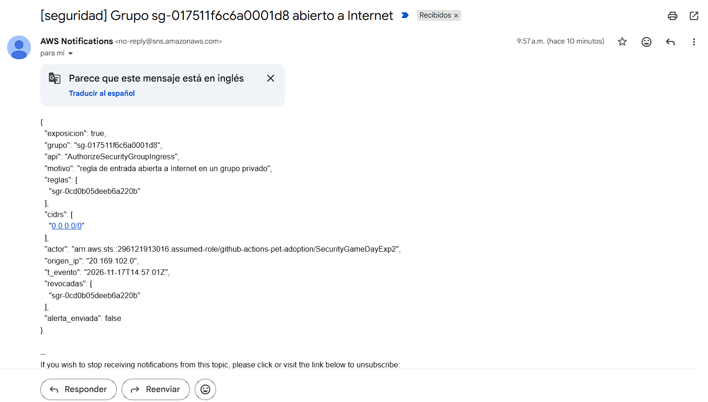
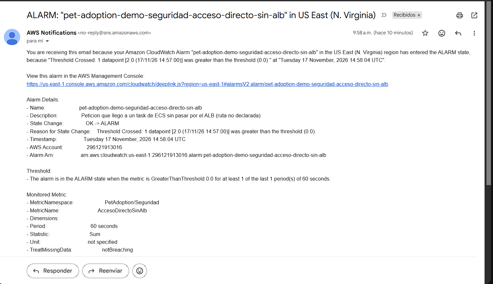

# Game day de Ingenieria del Caos de Seguridad: experimento 2, exposicion y segmentacion

Entrega final de Defensa en Profundidad (release `v5.0.0`). Integrante: Angel Avirama. Capa: **red**, en
la nube de AWS (API de adopcion). Es el aporte de AWS al informe del game day del grupo (los experimentos
1 y 4 y la parte de IA estan en el repositorio de Leonardo; el 3, en el de Juan). Aqui no se mide
rendimiento: se mide la **eficacia de los controles** (MTTD, MTTC, cobertura de deteccion y falsos
positivos). Este informe es distinto del de DevOps (`docs/chaos/INFORME_EXPERIMENTO.md`).

Evidencia con sello de tiempo: `chaos/security/results/exp2-ronda-0.json` y `exp2-ronda-1.json` (bitacora,
muestras, mediciones y resumen). Horas en Colombia (UTC-5).

## 1. Inventario de controles de la capa de red

| Control | Propietario | Senal que deberia producir | D3FEND | Antes del game day |
|---|---|---|---|---|
| Security group del ALB: solo HTTP desde Internet | Angel | — (preventivo) | D3-ITF | activo |
| Security group de ECS: solo el ALB al puerto 3000 | Angel | — (preventivo) | D3-ITF | activo |
| Security group de RDS: solo ECS al 5432; RDS sin IP publica, en subredes privadas | Angel | — (preventivo) | D3-ITF, D3-NI | activo |
| Filtrado de salida de ALB y ECS | Angel | conexion rechazada | D3-OTF | **sin filtrar** (todo a todo) |
| Registro de cambios de red (CloudTrail) | Angel | evento `AuthorizeSecurityGroupIngress` | D3-PM | solo historial de 90 dias, sin trail ni alerta |
| Alerta y contencion de reglas publicas (EventBridge + Lambda + SNS) | Angel | correo `[seguridad] Grupo ... abierto a Internet` | D3-NTF, D3-ITF | no existia |
| Senal de acceso sin ALB en la aplicacion (log con `traceId`) + alarma | Angel | log `acceso_directo_sin_alb`, alarma `...-acceso-directo-sin-alb` | D3-NTA | log si, alarma no |

## 2. Reglas de compromiso

- **Ventana:** cada ejecucion define `CHAOS_WINDOW` (50 min desde el inicio) y el workflow exige
  `ventana_autorizada=true`. Fuera de la ventana ninguna accion adversa arranca. Rondas ejecutadas el
  2026-11-16 (22:05-22:28) y el 2026-11-17 (09:56-10:00), acordadas con el grupo.
- **Radio de impacto:** solo los security groups `pet-adoption-demo-ecs-sg` y `pet-adoption-demo-rds-sg` y
  una tarea ECS de prueba en la cuenta AWS del grupo (296121913016). No se toco el ALB, RDS, otras cuentas,
  redes de la Universidad ni de terceros.
- **Cuentas autorizadas:** el rol OIDC `github-actions-pet-adoption`, limitado a dos ramas del repositorio
  (`aws/iam/deploy-trust-policy.json`).
- **Datos:** sinteticos (seed de Prisma).
- **Interruptor de parada:** el archivo `chaos/security/results/STOP` detiene cualquier accion adversa.
- **Plan de reversion:** toda regla creada lleva la marca `chaos-exp2`; `ejecutar.js revertir` las retira,
  verifica que no queda ninguna y que los tasks ya no son alcanzables. Corre siempre (`if: always()`).
  Se probo antes de la primera ronda con un simulador de la CLI de AWS.
- **Bitacora:** `bitacora` de cada `results/exp2-ronda-N.json`.

## 3. Hipotesis de control (falsable)

> Dado el control de red tal como esta configurado hoy, cuando aparezca una regla de entrada `0.0.0.0/0` en
> un security group privado (ECS o RDS), esperamos una **alerta que llegue al responsable** en un tiempo
> **T1 <= 5 minutos** y la **contencion** (regla retirada por un control, no por el experimento) en un
> tiempo **T2 <= 10 minutos**.

**Metrica objetivo** (declarada antes de la ronda 0): MTTD de la exposicion, con la cobertura de deteccion
(tecnicas detectadas sobre tecnicas emuladas) como metrica de guarda.

**Criterio de deteccion:** solo cuenta una alerta que llega a alguien. Un registro que nadie lee (CloudTrail o
un log) se reporta aparte como *senal registrada*. Este criterio se fijo al revisar la ronda 0, antes de la
ronda 1, y se aplico igual a las dos.

## 4. Tecnicas emuladas y metodo

| Caso | Condicion adversa | ATT&CK | Como se comprueba |
|---|---|---|---|
| ecs | Puerto 3000 de los tasks abierto a `0.0.0.0/0`: ruta no declarada que salta el ALB | T1562.007 | Cada 10 s: la regla sigue? un `GET` directo a la IP publica de cada task responde? (con `X-Trace-Id` `exp2-rN-ecs-...`) |
| rds | Puerto 5432 de la base de datos (administracion) abierto a `0.0.0.0/0` | T1562.007 | Cada 10 s: la regla sigue? |
| salida | Conexion desde un task a Internet por un puerto no permitido (TCP 80) | T1048 | Tarea ECS de prueba con la misma red: conecta a `example.com:80`? y a `sts.amazonaws.com:443` (permitido)? |

Mismo metodo en las dos rondas: `.github/workflows/security-gameday.yml` -> `chaos/security/exp2-exposicion/ejecutar.js`
(`estado-estable`, `abrir`, `vigilar` con un maximo de 600 s, `salida`, `revertir`, `medir`, `informe`).

## 5. Estado estable de seguridad (medido antes de tocar nada)

| Indicador | Ronda 0 (2026-11-16 22:05) | Ronda 1 (2026-11-17 09:56) |
|---|---|---|
| Reglas de entrada inesperadas | 0 | 0 |
| Tasks con IP publica / alcanzables directamente | 2 / no | 2 / no |
| Salida sin filtrar | ALB y ECS | ninguno |
| Trail de CloudTrail | no | si |
| Regla de EventBridge + Lambda de contencion | no | si |
| Alarma sobre la senal de la aplicacion | no | si |
| Alertas en la ultima hora sin condicion adversa | 0 | 0 |

## 6. Ronda 0: controles tal como estaban

| Hora | Que paso |
|---|---|
| 22:05:29 | Estado estable medido. |
| 22:05:34 | Se abre el 3000 del grupo de ECS (`sgr-0ffaae4868e01cc4d`). |
| 22:05:35 | CloudTrail registra `AuthorizeSecurityGroupIngress` (senal, 0,2 s). Nadie es avisado. |
| 22:05:38 | Primera peticion directa desde Internet al task: **200**. El log de la app registra `acceso_directo_sin_alb` con `traceId` `exp2-r0-ecs-mwk413qu` (senal, sin alarma). |
| 22:05-22:15 | 57 de 57 muestras: los dos tasks responden 200 desde Internet. La regla sigue ahi. |
| 22:15:47 | Fin de la observacion: **no contenida en 10 min**. |
| 22:15:48 | Se abre el 5432 del grupo de RDS. CloudTrail lo registra a 0,5 s. Nadie es avisado; la regla sigue 10 min. |
| 22:25:59 | Prueba de salida: el task **conecta** a `example.com:80`. |
| 22:27:00 | Reversion del experimento: dos reglas retiradas, verificada. |

**Resultado:** hipotesis **refutada**. Cobertura de deteccion **0/3**, contencion **0/3**, senal registrada 2/3.

**Diagnostico del mecanismo:** la exposicion fue real (los tasks tienen IP publica y solo el security group
los separaba de Internet) y la senal existia en dos capas (CloudTrail y el log de la aplicacion, con el trace
id de la peticion), pero **no habia ningun camino de la senal a una persona ni a una accion**. La salida sin
filtrar permitia, ademas, cualquier conexion saliente. Hallazgo a favor: el 5432 abierto **no expuso** la base
de datos, porque RDS esta en subredes privadas y no es publica: otra capa contuvo el riesgo.

## 7. Mejoras aplicadas (derivadas del diagnostico)

1. **Deteccion como codigo y contencion autonoma** (`terraform/seguridad.tf`): trail de CloudTrail -> regla de
   EventBridge con el patron versionado en `chaos/security/detecciones/01-sg-ingreso-publico.json` -> Lambda
   `pet-adoption-demo-revocar-ingreso-publico`, que decide con `decidir.js` (la misma funcion que prueban los
   tests), **retira la regla** y avisa por correo (SNS). Minimo privilegio: la Lambda solo puede
   `RevokeSecurityGroupIngress` sobre los dos grupos protegidos y `Publish` en su tema.
2. **Alerta sobre la senal de la aplicacion** (`02-acceso-directo-sin-alb.json`): filtro de metricas de
   CloudWatch sobre `acceso_directo_sin_alb` y alarma que avisa por el mismo correo. Es la segunda capa: si
   alguien abre una ruta por otro camino que no pase por la API de EC2, la peticion que llega igual se detecta.
3. **Denegacion por defecto y filtrado de salida** (`terraform/security_groups.tf`): ECS solo sale por 443
   (APIs de AWS y Grafana Cloud) y por 5432 hacia las subredes de la base de datos; el ALB solo habla con los
   tasks por el 3000; RDS no tiene salida.

**Deteccion como codigo, probada:** `node chaos/security/detecciones/evaluar.js` y
`tests/security.detecciones.test.js`. Regla 1: 3 positivos disparan (el experimento, IPv6 publico, regla
modificada) y 5 negativos callan (el ALB publico declarado, la referencia ALB->ECS de Terraform, un intento
fallido, una lectura, una regla de salida). Regla 2: 2 positivos y 3 negativos (trafico normal del coordinador
por el ALB, health check del ALB, metricas EMF). Terraform lee el patron y el filtro de esos mismos JSON.

## 8. Ronda 1: con las mejoras (mismo metodo)

| Hora | Que paso |
|---|---|
| 09:56:54 | Estado estable medido (controles activos, 0 alertas previas). |
| 09:57:00.6 | Se abre el 3000 del grupo de ECS (`sgr-0cd0b05deeb6a220b`). |
| 09:57:01 | CloudTrail registra el cambio. |
| 09:57:05 | Una peticion directa alcanza un task (200) y queda en el log con `traceId` `exp2-r1-ecs-mwktg1dh`. |
| 09:57:13.6 | **Alerta**: la Lambda decide `exposicion_detectada` (MTTD 13,0 s) y envia el correo. |
| 09:57:21.7 | **Contenida**: la regla ya no existe y el task no es alcanzable (MTTC 21,1 s). |
| 09:57:28.4 | Se abre el 5432 del grupo de RDS. |
| 09:57:41.5 | **Contenida** por la Lambda (MTTC 13,1 s). |
| 09:57:42.6 | Registro de la alerta de RDS (MTTD 14,2 s; ver hallazgo 2). |
| 09:57:42 | Prueba de salida: `example.com:80` **bloqueado**; `sts.amazonaws.com:443` permitido. |
| 09:58:04 | **Alarma** `acceso-directo-sin-alb` en ALARM (63,6 s tras la apertura) y correo. |
| 09:58:52 | Reversion del experimento: no quedaba ninguna regla (ya las habia retirado el control). |
| 09:59:04 | La alarma vuelve a OK y avisa. |

## 9. Comparacion de las dos rondas

| Metrica | Ronda 0 | Ronda 1 |
|---|---|---|
| **MTTD** exposicion ECS | no detectada (> 600 s) | **13,0 s** (EventBridge); 63,6 s (alarma de la app) |
| **MTTD** exposicion RDS | no detectada (> 600 s) | **14,2 s** |
| **MTTC** exposicion ECS | no contenida (> 600 s) | **21,1 s** |
| **MTTC** exposicion RDS | no contenida (> 600 s) | **13,1 s** |
| Salida a un puerto no permitido | conecta | **bloqueada** (prevencion) |
| Cobertura de deteccion | **0/3** | **2/3** |
| Contencion | 0/3 | **3/3** |
| Senal registrada | 2/3 | 2/3 |
| Falsos positivos (estado estable y casos negativos) | 0 | 0 |
| Tiempo expuesto a Internet (ECS) | 10 min (hasta la reversion manual) | 21 s |
| **Hipotesis** (T1 <= 5 min, T2 <= 10 min) | **refutada** | **se mantiene** |

**Tasa base y falsos positivos:** la regla 1 solo mira dos grupos que nunca deben tener origen publico, y la
regla 2 solo trafico que no paso por el ALB, que en operacion normal es cero. Con una tasa base tan baja, un
solo falso positivo desplomaria la precision; por eso los casos negativos incluyen los cambios legitimos de
Terraform y el trafico real del flujo, y ninguno dispara.

**Correlacion por trace id:** la peticion `exp2-r0-ecs-mwk413qu` (ronda 0) aparece en el log de la aplicacion
con su `otelTraceId` `e9ca9e39...`, la IP de origen (el runner de GitHub) y el agente `exp2-sonda-externa`,
lo que permite a un tercero reconstruir que peticion entro por la ruta no declarada, cuando y desde donde.

## 10. Hallazgos inesperados

1. **La exposicion de RDS no era explotable** gracias a otra capa (subredes privadas, `publicly_accessible =
   false`); igual se detecta y se contiene, porque la regla viola la politica aunque hoy no exponga datos.
2. **MTTD mayor que MTTC en RDS** (14,2 s frente a 13,1 s): el MTTD se mide con la hora de ingesta del log
   de la Lambda en CloudWatch, que llega uno o dos segundos despues de que la Lambda ya retiro la regla.
3. **La alarma de la aplicacion es mas lenta** (63,6 s) por su periodo de evaluacion de 60 s, pero es
   independiente de CloudTrail: sigue funcionando aunque alguien desactive el trail.
4. Al revisar la ronda 0 se vio que el primer resumen contaba el log de la aplicacion como deteccion. Se
   corrigio el criterio (solo cuenta una alerta que llega a alguien) y se recalculo la ronda 0 antes de la 1.
5. El primer intento de la ronda 0 parecio colgado; era la pagina de GitHub que dejo de refrescar el log.
   Igual se agregaron limites de tiempo a cada llamada para que una ronda nunca deje una regla abierta.

## 11. Mapeo y trazabilidad

| Control | Experimento | ATT&CK | D3FEND | ISO/IEC 27001:2022 | NIST SP 800-53 | NIST SP 800-207 |
|---|---|---|---|---|---|---|
| Alerta y contencion de reglas publicas | 2 (ecs, rds) | T1562.007 | D3-ITF, D3-NTF | A.8.20 seguridad de redes, A.8.16 monitoreo | SC-7, SI-4, IR-4 | verificacion continua |
| Alarma de acceso sin ALB | 2 (ecs) | T1562.007, T1190 | D3-NTA | A.8.16 | SI-4, AU-6 | verificacion continua |
| Filtrado de salida y denegacion por defecto | 2 (salida) | T1048 | D3-OTF | A.8.20, A.8.22 segregacion de redes | SC-7(5) denegar por defecto | microsegmentacion |
| Base de datos en subredes privadas | 2 (rds) | T1562.007 | D3-NI | A.8.22 | SC-7 | microsegmentacion |
| Rol OIDC limitado por rama, Lambda con minimo privilegio | 2 | T1078.004 | D3-UAP | A.5.15, A.8.2 | AC-6 | minimo privilegio |

**Tendencia del sector instrumentada:** remediacion autonoma de una exposicion del flujo. La contencion la
hace la Lambda sin esperar a una persona; la aprobacion humana esta en el codigo (la politica de que grupos
se protegen se revisa y se aprueba en el repositorio) y cada accion queda registrada (log de la Lambda y
correo al responsable). El experimento 1 del grupo cubre la variante con aprobacion humana por incidente.

## 12. Lecciones, riesgos residuales y proximos experimentos

- **Leccion:** la senal ya existia; lo que faltaba era convertirla en alerta y en accion. Detectar no sirve si
  nadie se entera.
- **Riesgos residuales:**
  - Los tasks tienen IP publica: el security group es la unica barrera de entrada. Moverlos a subredes
    privadas exige NAT Gateway o endpoints de VPC (costo).
  - La salida por 443 sigue abierta a cualquier destino (los security groups filtran por IP, no por nombre).
  - La salida no tiene deteccion (haria falta VPC Flow Logs o AWS Network Firewall).
  - Quien tenga permisos para borrar la Lambda o el trail desactiva la contencion (T1562.008); la alarma de
    la aplicacion es la red de seguridad.
  - Las rutas de la v3 y la v4 que llamaban a otras APIs por HTTP dejan de funcionar con el filtrado de salida
    (fuera del flujo v5; riesgo aceptado).
- **Proximos experimentos:** desactivar el trail o la Lambda y medir si la alarma de la aplicacion lo cubre;
  salto este-oeste desde un task hacia otro servicio de la VPC; VPC Flow Logs para detectar salida rechazada.

## Apoyo de IA

Se uso Claude (Anthropic) para diseñar el experimento, escribir las herramientas, Terraform y este informe.
Los numeros vienen de `results/*.json` y de los correos reales, no del modelo. Contraste humano: AWS Config se
descarto por costo y por latencia (minutos) frente a EventBridge (segundos); se descarto contener cualquier
regla `0.0.0.0/0` sin mirar el grupo, porque habria roto el ALB, que es publico por diseño; y fue la revision
de la ronda 0 la que corrigio el criterio de deteccion que el asistente habia propuesto al principio.
